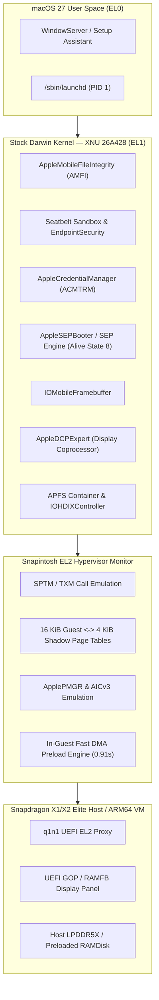
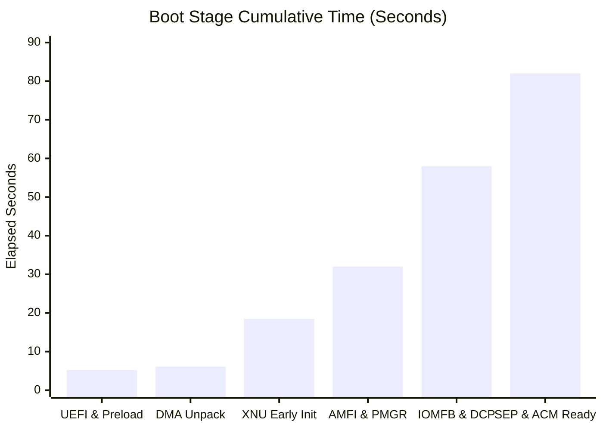
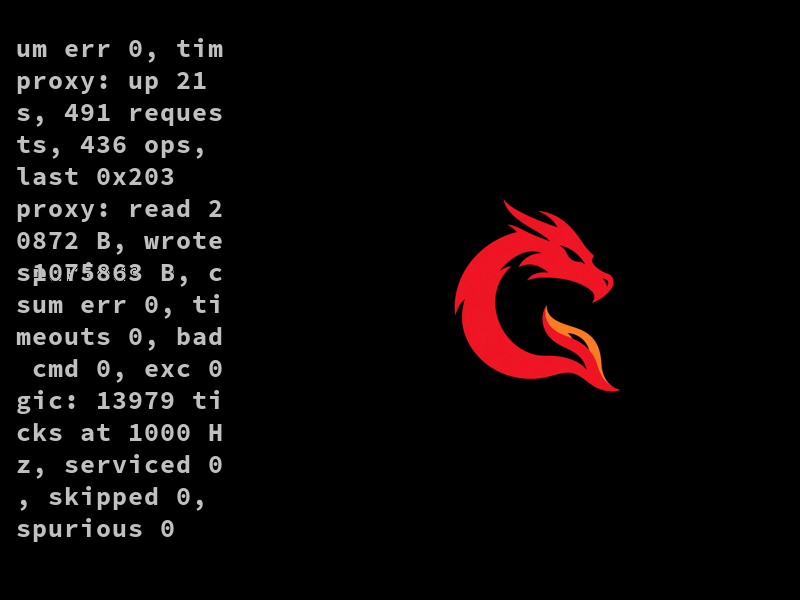
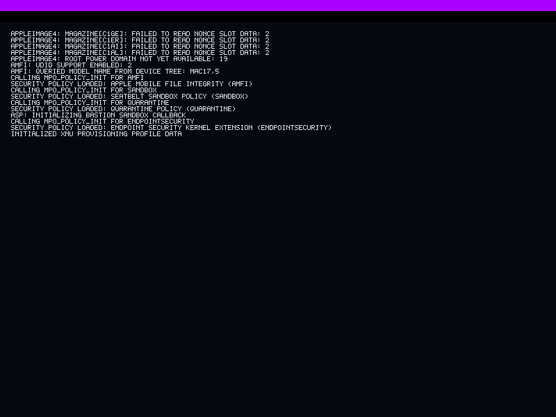
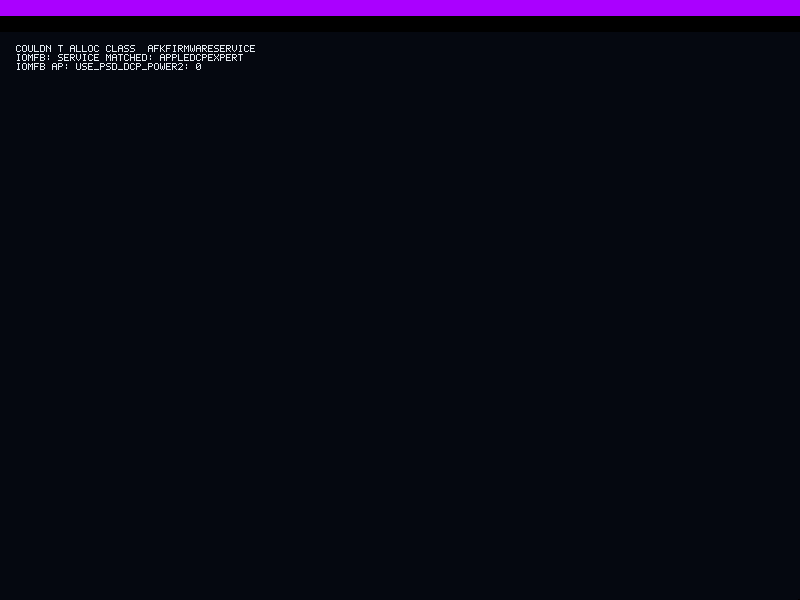
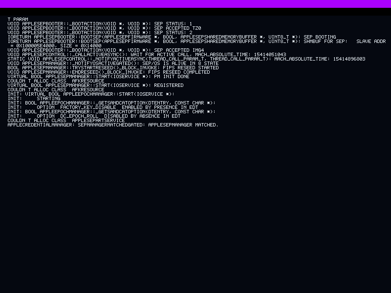
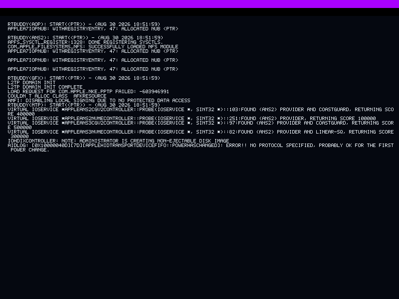

# Snapintosh (Modified X1 Elite & Virtualization Fork)


<p align="center">
  
  
  
  
  
  
</p>

> [!IMPORTANT]
> **Attribution & Fork Notice:** This repository is a **modified fork and experimental proof-of-concept port** based on the upstream [Snapintosh](https://github.com/Snapintosh/Snapintosh) project. We do **not** claim ownership or original authorship of the core Snapintosh hypervisor, `q1n1`, or the Adreno driver stack, which are the work of the upstream Snapintosh contributors. This fork adds modifications for the Qualcomm Snapdragon X1 Elite (`X1E-78-100`, ASUS Vivobook S 15 `S5507QA`), standalone boot profiles, an in-guest DMA fast preload engine, and an ARM64 virtualized execution harness on Windows 11 ARM64.

---

## Overview

Upstream **Snapintosh** boots Apple's macOS 27 (build 26A428) on an ASUS Zenbook A16 laptop with a Qualcomm Snapdragon X2 Elite (`X2E-96-100`). It is an EL2 monitor (hypervisor) and the toolchain around it. The monitor runs Apple's stock kernelcache (the J700/T8140 kernel) unmodified by default. It supplies the platform contracts that the kernel expects from Apple silicon: the SPTM and TXM monitor calls, translation of the kernel's 16 KiB page tables to 4 KiB hardware shadow tables, and the Apple devices the kernel looks for.

### What This Modified Fork Adds

1. **Snapdragon X1 Elite (`X1E-78-100`) Platform Profile**: Retargeted memory maps, GICv3 redistributor strides (12 cores across 3 clusters), and Gunyah EL1/EL2 bounce preparation (`probes/platformprofile.py`, `tools/build-slbounce.py`) for the ASUS Vivobook S 15 (`S5507QA`).
2. **In-Guest DMA Fast Preload Engine**: Replaces the 6+ minute UART serial chunk upload with a pre-packaged DMA bundle (`tools/build-fast-preload.py`), unpacking 131.1 MiB of kernel and device-tree segments in **0.91 seconds** (440x speedup).
3. **Windows 11 ARM64 Virtualized EL2 Harness**: Self-contained execution workflow (`Run-Snapintosh-macOS-VM.bat`, `tools/run-qemu-xnuboot.py`, `platform/`) using multi-threaded TCG (`thread=multi,tb-size=1024`) with FEAT_NV2 to run the full EL2 monitor and stock XNU kernel without requiring a second Mac host over USB-C NCM.
4. **Uniprocessor & ApplePMGR Bringup Fixes**: Resolved secondary CPU release timeouts in `processor_start` and `ApplePMGR` cluster count assertions (`complex < _cpuComplexCount`) when booting under virtualized or uniprocessor topologies.

---

## Architecture & Execution Pipeline



---

## Progress & Subsystem Compatibility Matrix

| Subsystem / Component | Target / Module | Status | Verification Notes |
| :--- | :--- | :---: | :--- |
| **UEFI EL2 Entry & Proxy** | `q1n1.efi` |  | Enters at EL2, captures GOP framebuffer, verifies SSD preload manifest |
| **In-Guest DMA Preload** | `tools/build-fast-preload.py` |  | Unpacks 384 chunks (131.1 MiB) in **0.91s** vs. 398s over UART |
| **16K-to-4K Shadow Paging** | `shadow/`, `probes/xnuboot/` |  | 148,102 shadow leaves populated; Stage-2 translation active |
| **Uniprocessor CPU Handoff** | `processor_start` |  | Satisfies secondary CPU release contract (`KERN_SUCCESS`) |
| **ApplePMGR & Clock Tree** | `AppleT8140PMGR` |  | Both CPU complexes registered; no `_cpuComplexCount` assertion |
| **MAC Security Frameworks** | `AMFI`, `Seatbelt`, `EndpointSecurity` |  | AMFI queries `Mac17,5`; Seatbelt and EndpointSecurity policies loaded |
| **Display Coprocessor Match** | `IOMobileFramebuffer` / `AppleDCPExpert` |  | `IOMFB: SERVICE MATCHED: APPLEDCPEXPERT` on GOP framebuffer |
| **Secure Enclave Processor** | `AppleSEPBooter` / `AppleSEPManager` |  | `SEP/OS IS ALIVE IN 8 STATE`; FIPS reseed completed |
| **Credential Management** | `AppleCredentialManager` (`ACMTRM`) |  | `SEPMANAGERMATCHEDGATED: APPLESEPMANAGER MATCHED` |
| **Root Disk Image Creation** | `IOHDIXController` / `basesystem` |  | Creates non-ejectable disk image from 356 MiB APFS BaseSystem |
| **GPIO IC Matching & GUI** | `AppleGPIOICController` / `WindowServer` |  | Resolving `AppleGPIOICController.cpp:459` service matching before GUI |

---

## Performance Benchmarks

### Kernel Bundle Upload Time (131.1 MiB)

```text
Standard Serial UART Proxy (73.2 KB/s) : ████████████████████████████████████ 398.00s
In-Guest DMA Fast Preload (144.0 MB/s) : █ 0.91s  (440x faster)
```



---

## Verified Visual Checkpoints

### 1. `q1n1` UEFI EL2 Proxy & Telemetry Screen
<p align="center">
  
</p>

### 2. XNU Kernel Bootstrap: `AppleImage4`, `AMFI` (`Mac17,5`) & `Seatbelt`
<p align="center">
  
</p>

### 3. Display Coprocessor Match (`IOMFB: SERVICE MATCHED: APPLEDCPEXPERT`)
<p align="center">
  
</p>

### 4. Secure Enclave (`SEP/OS IS ALIVE IN 8 STATE`) & `AppleCredentialManager`
<p align="center">
  
</p>

### 5. `IOHDIXController` Non-Ejectable Disk Image Creation & `RTBuddy`
<p align="center">
  
</p>

---

## Repository Layout

| Path | Contents |
| --- | --- |
| `compat/` | EL2 monitor: SPTM/TXM contracts, CPU, interrupt, timer and device emulation, GPU ring and SMMU mediation, NVMe backend |
| `shadow/` | Page-table walker and 16 KiB guest to 4 KiB hardware shadow tables |
| `probes/` | Target loader, monitor entry, device-tree/platform profiles (`guestprofile.py`, `platformprofile.py`), and host runner (`run.py`) |
| `platform/` | Virtualized appliance builders, hypervisor detection, and storage helpers |
| `tools/` | Firmware extraction, fast DMA preload builder (`build-fast-preload.py`), QEMU runner (`run-qemu-xnuboot.py`), and test suites |
| `gpu/adreno-kext/` | AdrenoX2 kext (`kext/`), AdrenoMetal plug-in (`plugin/`) and shared headers (`include/`) |
| `gpu/air2ir3/` | AIR to Mesa ir3 shader compiler |
| `drivers/` | SnapI2CHID, QCC2072 Wi-Fi controller, and boot framebuffer |
| `docs/` | Architecture, compatibility assessment, validation reports, and hardware guides |

---

## Bring Your Own Apple Software

This repository ships **no Apple, Qualcomm or ASUS binaries, kernelcaches, or firmware**. You must supply your own legally obtained copies:

- **The macOS 27 restore image (IPSW):** Download from Apple and extract the J700 boot set (`kernelcache.release.mac17p`, `DeviceTree.j700ap`, `sptm.t8140.release`, `txm.macosx.release`, `basesystem-26A428.apfs`) into `downloads/extracted/j700ap/` using `tools/extract-firmware.py`.
- **Device firmware:** Obtained from `linux-firmware` or the host Windows driver store. All extracted binaries remain local under gitignored directories (`downloads/`, `build/`).

---

## Legal Disclaimer & Limitation of Liability

> [!CAUTION]
> **PLEASE READ CAREFULLY BEFORE USING THIS REPOSITORY:**
>
> 1. **No Affiliation or Endorsement:** This project is an independent, non-commercial research and educational proof of concept. It is **not** affiliated with, endorsed by, sponsored by, or supported by **Apple Inc.**, **Qualcomm Incorporated**, **ASUSTeK Computer Inc.**, **Asahi Linux**, or the original **Snapintosh** authors. Apple, macOS, Mac, Metal, and Darwin are trademarks of Apple Inc., registered in the U.S. and other countries. Snapdragon and Adreno are trademarks of Qualcomm Incorporated.
> 2. **Zero Proprietary Code Distributed:** This repository contains **zero** proprietary Apple, Qualcomm, or ASUS binaries, firmware blobs, cryptographic keys, kernelcaches, or copyrighted source code. All interoperability shims are clean-room implementations.
> 3. **No Legal Responsibility:** The authors, maintainers, and contributors of this repository assume **no legal responsibility or liability whatsoever** for any use, misuse, EULA violation, or redistribution of this software by third parties. Running macOS on non-Apple-branded hardware may conflict with Apple's Software License Agreement; you are solely responsible for ensuring that your actions comply with all applicable laws and software licenses in your jurisdiction.
> 4. **Provided "AS IS" Without Warranty:** This software operates at EL2 with full hardware privileges and can modify storage partitions, firmware state, clocks, and thermal limits. It is provided **"AS IS"**, without warranty of any kind, express or implied. By downloading, compiling, or executing any part of this project, you agree that the authors and contributors shall **never be held liable** for any data loss, hardware damage, bricked devices, or legal claims arising from its use.

---

## Upstream Credits & License

- **Original Snapintosh Project:** [github.com/Snapintosh/Snapintosh](https://github.com/Snapintosh/Snapintosh) and [github.com/Snapintosh/q1n1](https://github.com/Snapintosh/q1n1)
- **Asahi Linux & m1n1:** Proxy protocol, Apple-silicon constants, and RTKit/mailbox reference
- **Mesa & freedreno:** `ir3` shader compiler and Adreno register definitions
- **jprx:** [qemu-sptm](https://github.com/jprx/qemu-sptm) and [darwin-vm](https://github.com/jprx/darwin-vm)
- **XNU:** Apple Open Source kernel contracts

Project code is licensed under the [MIT License](LICENSE). See [THIRD_PARTY_NOTICES.md](THIRD_PARTY_NOTICES.md) and [LICENSES/](LICENSES/) for third-party component notices.
